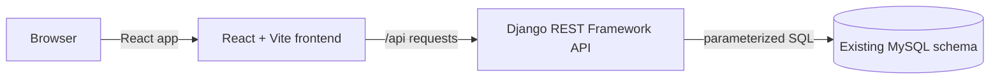

# Railway Reservation System

Coursework project using Django REST Framework, React, and MySQL. Project requirements and test references are in [Documents](Documents/).

## Architecture



During development, `run-dev.sh` starts the Vite frontend and Django API as separate local servers; Vite forwards `/api` requests to Django. For a built deployment, Django can serve the generated React assets. Django keeps the existing MySQL schema and accesses it through the project's parameterized `mysql-connector-python` services.

## Setup
1. Install Python 3.10+, Node.js 20+, MySQL 8.x, [uv](https://docs.astral.sh/uv/), and npm.
2. Create and activate a Python virtual environment: `uv venv`, then `source .venv/bin/activate` (Windows PowerShell: `.venv\\Scripts\\Activate.ps1`).
3. Install backend dependencies: `uv pip install -r requirements.txt`.
4. Install frontend dependencies from the lockfile: `cd frontend && npm ci && cd ..`.
5. Copy `.env.example` to `.env` and set your MySQL credentials. Use a high-entropy `SECRET_KEY` and never commit `.env`.
6. Create the project schema if needed: `mysql -u root -p < database/schema.sql`. The app uses that existing schema and does not run Django migrations against it.
7. Run `./run-dev.sh` from the repository root, then open http://127.0.0.1:5173. This single launcher starts the Django REST API and React/Vite frontend together, creates `.venv` if needed, and installs missing project dependencies. MySQL must already be running with the existing schema; the script does not create or migrate database tables. Press Ctrl+C to stop both servers.

To serve the built React app from Django, run `cd frontend && npm run build`, then open http://127.0.0.1:8000. Django serves the generated files from the ignored `frontend/dist/` directory.

The API uses Django signed-cookie sessions and Django CSRF protection. Cookies are HttpOnly for sessions, SameSite=Lax, and have a 30-minute lifetime. Set `SESSION_COOKIE_SECURE=true` behind HTTPS. The existing services continue to issue parameterized `mysql-connector-python` SQL against `database/schema.sql`; no tables or columns were renamed or added for the migration.

## Administrator login (Issue #5)
Admin accounts are existing `users` rows with `role='ADMIN'` and `account_status='ACTIVE'`. Public registration cannot set a role. Create the initial admin through a trusted, access-controlled database administration process; do not expose public admin creation.

- `POST /api/admin/login`: JSON `{"email":"admin@example.com","password":"your-password"}`; verifies the stored Werkzeug password hash, role, and active status, then establishes a session.
- `POST /api/admin/logout`: clears the authenticated admin session.

Example:
```bash
curl -i -c cookies.txt http://127.0.0.1:8000/api/csrf
curl -i -b cookies.txt -H 'X-CSRFToken: <token>' -H 'Content-Type: application/json' -d '{"email":"admin@example.com","password":"your-password"}' http://127.0.0.1:8000/api/admin/login
curl -i -b cookies.txt -H 'X-CSRFToken: <token>' -X POST http://127.0.0.1:8000/api/admin/logout
```

## Passenger login and logout (Issue #4)
- `POST /api/login`: JSON `{"email":"passenger@example.com","password":"your-password"}`; verifies an active passenger account and establishes a session.
- `GET /api/session`: restores the current passenger session.
- `POST /api/logout`: clears the passenger session.

## Tests
Run `cd frontend && npm ci && npm run build && cd ..`, then `uv run --active python -m unittest discover -s backend/tests -v` from the repository root. Tests exercise Django/DRF endpoints, CSRF/session behavior, the React build entry and lockfile, and the one-command launcher; database access is mocked, so no development MySQL database is changed by the test suite.

## Current scope
The implemented scope is limited to the completed project-board features: project setup and database schema; passenger registration and login/logout; administrator login; train search and results with travel-class fares and seat availability; passenger details and fare calculation; ticket booking with duplicate-request protection and a unique PNR; and simulated payment. Refunds, booking history, and train/route/schedule administration are outside the current scope. Administrator login is an API flow; create an admin account only through a trusted local database administration process.

## Ticket booking (Issue #13)
Signed-in passengers can choose a train, enter traveler details, and reserve seats. The booking, passenger fares, and expiring seat allocations are written in one transaction. Seat availability is checked again while the schedule inventory is locked. Each successful booking receives a unique 12-character PNR, stored with the booking and shown to the passenger. The payment step uses the simulator described below.

## Payment (Issue #16)
The payment flow uses the existing `payments` table and a simulated provider. It displays the server-calculated booking amount, records success or failure, and confirms the booking and its held seats only after simulated success. A failed attempt is recorded and leaves the booking pending while its 15-minute seat hold remains active, so a new attempt can be made before expiry. The interface clearly labels both outcomes as simulations; it does not collect card details or process real payments.

The passenger payment endpoint is `POST /api/bookings/<booking_id>/payment` with JSON `{"idempotency_key":"<unique-request-key>","simulated_outcome":"SUCCESS"}`. Set `simulated_outcome` to `FAILURE` to exercise the decline path. The server loads the payable amount and ownership from the booking record; the client cannot set the amount.
