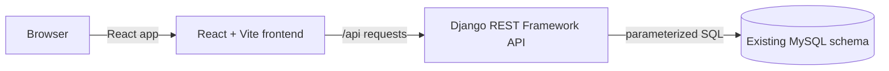

# Railway Reservation System

Coursework project using Django REST Framework, React, and MySQL. Project requirements and test references are in [Documents](Documents/).\n\n**[Read the complete project documentation](docs/PROJECT_DOCUMENTATION.md)** for setup instructions, architecture, database schema, API reference, security notes, testing, and troubleshooting.

## Architecture



During development, `run-dev.sh` starts the Vite frontend and Django API as separate local servers; Vite forwards `/api` requests to Django. For a built deployment, Django can serve the generated React assets. Django keeps the existing MySQL schema and accesses it through the project's parameterized `mysql-connector-python` services.

## Setup
1. Install Python 3.10+, Node.js 20+, MySQL 8.x, [uv](https://docs.astral.sh/uv/), and npm.
2. Create and activate a Python virtual environment: `uv venv`, then `source .venv/bin/activate` (Windows PowerShell: `.venv\\Scripts\\Activate.ps1`).
3. Install backend dependencies: `uv pip install -r requirements.txt`.
4. Install frontend dependencies from the lockfile: `cd frontend && npm ci && cd ..`.
5. Copy `.env.example` to `.env` and set your MySQL credentials. Use a high-entropy `SECRET_KEY` and never commit `.env`.
6. Create the project schema if needed: `mysql -u root -p < database/schema.sql`. The app uses that existing schema and does not run Django migrations against it.
7. Run `./run-dev.sh` from the repository root, then open http://127.0.0.1:5173. This single launcher starts the Django REST API and React/Vite frontend together, creates `.venv` if needed, and installs missing project dependencies. MySQL must already be running with the existing schema; the script does not create or migrate database tables. Press Ctrl+C to stop both servers.

To serve the built React app from Django, run `cd frontend && npm run build`, then open http://127.0.0.1:8000. Django serves the generated files from the ignored `frontend/dist/` directory.

The API uses Django signed-cookie sessions and Django CSRF protection. Session cookies are HttpOnly, SameSite=Lax, and have a 30-minute lifetime. Session and CSRF cookies default to `Secure` when `APP_DEBUG=false`; set `APP_DEBUG=true` only for local HTTP development. Production deployments must use HTTPS. Browser responses also set `X-Content-Type-Options: nosniff`, `Referrer-Policy: same-origin`, and `X-Frame-Options: DENY`. Enable HSTS with `SECURE_HSTS_SECONDS` only after HTTPS is correctly configured. Registration stores passwords as Werkzeug scrypt hashes; login verifies the encoded hash and never returns it to clients. Passenger booking, payment, status, and cancellation services scope lookups by the authenticated user ID, while every admin data/action endpoint requires an administrator session. The existing services continue to issue parameterized `mysql-connector-python` SQL against `database/schema.sql`; no tables or columns were renamed or added for the migration.

## Administrator login (Issue #5)
Admin accounts are existing `users` rows with `role='ADMIN'` and `account_status='ACTIVE'`. Public registration cannot set a role. Create the initial admin through a trusted, access-controlled database administration process; do not expose public admin creation.

- `POST /api/admin/login`: JSON `{"email":"admin@example.com","password":"your-password"}`; verifies the stored Werkzeug password hash, role, and active status, then establishes a session.
- `POST /api/admin/logout`: clears the authenticated admin session.

Example:
```bash
curl -i -c cookies.txt http://127.0.0.1:8000/api/csrf
curl -i -b cookies.txt -H 'X-CSRFToken: <token>' -H 'Content-Type: application/json' -d '{"email":"admin@example.com","password":"your-password"}' http://127.0.0.1:8000/api/admin/login
curl -i -b cookies.txt -H 'X-CSRFToken: <token>' -X POST http://127.0.0.1:8000/api/admin/logout
```

## Passenger login and logout (Issue #4)
- `POST /api/login`: JSON `{"email":"passenger@example.com","password":"your-password"}`; verifies an active passenger account and establishes a session.
- `GET /api/session`: restores the current passenger session.
- `POST /api/logout`: clears the passenger session.

## Tests
Run `cd frontend && npm ci && npm run build && cd ..`, then `uv run --active python -m unittest discover -s backend/tests -v` from the repository root. Tests exercise Django/DRF endpoints, CSRF/session behavior, the React build entry and lockfile, and the one-command launcher; database access is mocked, so no development MySQL database is changed by the test suite.

## Availability and recovery (Issue #39)

The coursework project's **proposed availability objective is 99.5% per calendar month**, excluding announced maintenance. This is a planning target, not a measured uptime result or a production SLA. The current local-development deployment is a single Django process, a Vite development server, and one MySQL instance; it does not provide automatic failover or high availability.

### Health checks

- `GET /api/health` checks whether the Django API is responding. It does not require MySQL.
- `GET /api/health/db` checks the MySQL connection. It returns HTTP 200 when connected and HTTP 503 when the database is unavailable.
- Database-dependent API endpoints return a controlled error response (normally HTTP 503) for database outages instead of exposing database exception details.

### Restart and recovery procedure

1. Start or restart MySQL and confirm the `railway_reservation` schema is available.
2. From the repository root, start both application services with `./run-dev.sh`. If they are already running, stop them with Ctrl+C and run the command again.
3. Check `http://127.0.0.1:8000/api/health`; expect HTTP 200 and `{"status":"ok"}`.
4. Check `http://127.0.0.1:8000/api/health/db`; expect HTTP 200 and `{"status":"ok","database":"connected"}`.
5. Open `http://127.0.0.1:5173` and verify the frontend loads and can make API requests.
6. If the API health check fails, inspect the Django terminal output. If only the database check fails, verify MySQL is running and that the local `.env` credentials and database name are correct, then retry the database health check.

The application uses Django signed-cookie sessions, so session data is self-contained and can be verified by a fresh application worker after a restart as long as the same `SECRET_KEY` and cookie settings are retained. Users may still need to sign in again if cookies expire, are cleared, or the signing key changes.

Automated regression tests cover API health during a database outage, safe 503 responses, database recovery, and signed-session restoration by a fresh client. These tests validate application behavior with mocked database connections; they do not measure real-world uptime or replace deployment-level monitoring and failover testing.

## Current scope
The implemented scope includes project setup and database schema; passenger registration and login/logout; administrator login and a protected administrator dashboard; train search, fares, and seat availability; passenger details and fare calculation; ticket booking with duplicate-request protection and a unique PNR; passenger booking history and cancellation/refund records. The administrator dashboard is available from the **Admin** link in the navigation (or `/?admin=1`) after the frontend starts. It provides operational summaries, train activation/deactivation, route stops, schedules and seat inventory, bookings, and cancellation records. Dashboard APIs require an active administrator session. Create an admin account only through a trusted local database administration process. Ticket bookings reserve seats for 15 minutes and remain pending payment; the dashboard does not initiate payments or refunds.

## Ticket booking (Issue #13)
Signed-in passengers can choose a train, enter traveler details, and reserve seats. The booking, passenger fares, and expiring seat allocations are written in one transaction. Seat availability is checked again while the schedule inventory is locked. Each successful booking receives a unique 12-character PNR, stored with the booking and shown to the passenger. Payment is a separate feature.
