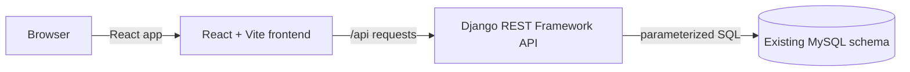

# Railway Reservation System

Coursework project using Django REST Framework, React, and MySQL. Project requirements and test references are in [Documents](Documents/).

## Architecture



During development, `run-dev.sh` starts the Vite frontend and Django API as separate local servers; Vite forwards `/api` requests to Django. For a built deployment, Django can serve the generated React assets. Django keeps the existing MySQL schema and accesses it through the project's parameterized `mysql-connector-python` services.

## Setup
1. Install Python 3.10+, Node.js 20+, MySQL 8.x, [uv](https://docs.astral.sh/uv/), and npm.
2. Create and activate a Python virtual environment: `uv venv`, then `source .venv/bin/activate` (Windows PowerShell: `.venv\\Scripts\\Activate.ps1`).
3. Install backend dependencies: `uv pip install -r requirements.txt`.
4. Install frontend dependencies from the lockfile: `cd frontend && npm ci && cd ..`.
5. Copy `.env.example` to `.env` and set your MySQL credentials. Use a high-entropy `SECRET_KEY` and never commit `.env`.
6. Create the project schema if needed: `mysql -u root -p < database/schema.sql`. The app uses that existing schema and does not run Django migrations against it.
7. Run `./run-dev.sh` from the repository root, then open http://127.0.0.1:5173. This single launcher starts the Django REST API and React/Vite frontend together, creates `.venv` if needed, and installs missing project dependencies. MySQL must already be running with the existing schema; the script does not create or migrate database tables. Press Ctrl+C to stop both servers.

### Local train data
To seed a local Karnataka network, run `sudo .venv/bin/python database/seed_demo.py --db-user root --unix-socket /run/mysqld/mysqld.sock` from the repository root. The seed contains 36 major stations using real Karnataka station names and codes, five local demo services from every station, and daily schedules for the current calendar month. That gives five searchable services for every ordered station pair. These generated connecting services and daily timetables are demo data, not an official complete Indian Railways timetable. Each train gets Sleeper and AC 3 Tier inventory with eight seats per class. The script also creates demo passenger and administrator accounts; their credentials are listed in the local demo section below. Re-running the seed preserves bookings and payments.

Local account credentials:

- Passenger: `passenger@trackline.local` / `RailDemoUser#26`
- Administrator: `admin@trackline.local` / `RailDemoAdmin#26`

These public demo credentials are for local coursework only. Do not use them for a deployed or production system.

To serve the built React app from Django, run `cd frontend && npm run build`, then open http://127.0.0.1:8000. Django serves the generated files from the ignored `frontend/dist/` directory.

The API uses Django signed-cookie sessions and Django CSRF protection. Cookies are HttpOnly for sessions, SameSite=Lax, and have a 30-minute lifetime. Set `SESSION_COOKIE_SECURE=true` behind HTTPS. The existing services continue to issue parameterized `mysql-connector-python` SQL against `database/schema.sql`; no tables or columns were renamed or added for the migration.

## Shared login and administrator access (Issues #4 and #5)
Admin accounts are existing `users` rows with `role='ADMIN'` and `account_status='ACTIVE'`. Public registration cannot set a role. Create the initial admin through a trusted, access-controlled database administration process; do not expose public admin creation.

- `POST /api/login`: JSON `{"email":"admin@example.com","password":"your-password"}`; verifies the stored Werkzeug password hash, role, and active status, then establishes a session and returns `role: ADMIN` or `role: PASSENGER`. The React login form sends administrators to Payment review.
- `POST /api/admin/logout`: clears the authenticated admin session.

Example:
```bash
curl -i -c cookies.txt http://127.0.0.1:8000/api/csrf
curl -i -b cookies.txt -H 'X-CSRFToken: <token>' -H 'Content-Type: application/json' -d '{"email":"admin@example.com","password":"your-password"}' http://127.0.0.1:8000/api/login
curl -i -b cookies.txt -H 'X-CSRFToken: <token>' -X POST http://127.0.0.1:8000/api/admin/logout
```

## Passenger login and logout (Issue #4)
- `POST /api/login`: JSON `{"email":"passenger@example.com","password":"your-password"}`; verifies an active account and establishes a session using the role stored in MySQL.
- `GET /api/session`: restores the current passenger session.
- `POST /api/logout`: clears the passenger session.

## Tests
Run `cd frontend && npm ci && npm run build && cd ..`, then `uv run --active python -m unittest discover -s backend/tests -v` from the repository root. Tests exercise Django/DRF endpoints, CSRF/session behavior, the React build entry and lockfile, and the one-command launcher; database access is mocked, so no development MySQL database is changed by the test suite.

## Current scope
The implemented scope includes passenger registration and login/logout; administrator login; train search and results with travel-class fares and seat availability; passenger details and fare calculation; ticket booking with duplicate-request protection and a unique PNR; passenger ticket history; and administrator-reviewed demo payment approval. Refunds and full train/route/schedule administration are outside the current scope.

## Ticket booking (Issue #13)
Signed-in passengers can choose a train, enter traveler details, and reserve seats. The booking, passenger fares, and expiring seat allocations are written in one transaction. Seat availability is checked again while the schedule inventory is locked. Each successful booking receives a unique 12-character PNR, stored with the booking and shown to the passenger. The payment step uses administrator review as described below.

## Payment (Issue #16)
The payment flow uses the existing `payments` table without a gateway. A passenger submits an approval request; an authenticated administrator reviews it and approves or rejects it. Approval confirms the booking and held seats in one transaction. Rejection records a failed request and leaves the booking pending while the 15-minute seat hold remains active. The app does not collect card details or process real payments.

The passenger payment endpoint is `POST /api/bookings/<booking_id>/payment` with JSON `{"idempotency_key":"<unique-request-key>"}`. The admin review queue is `GET /api/admin/payments/pending`; approve or reject with `POST /api/admin/payments/<payment_id>/review` and `{"decision":"APPROVE"}` or `{"decision":"REJECT"}`. The server loads amount and booking ownership from the database; the client cannot mark its own payment successful.

## Failed payments (Issue #17)
A rejected request is saved with status `FAILED`; it does not confirm the booking or seat allocations. The passenger can submit another request while the temporary 15-minute seat hold remains active. An administrator cannot approve a request after its hold expires.

## Verification and local database permissions

The latest scope and actual checks are in [the verification report](Documents/VERIFICATION_2026-11-19.md).
`run-dev.sh` explicitly trusts the Vite browser origins for CSRF and uses a strict frontend port. Restart the launcher after configuration/backend changes. When starting both servers separately, set `CSRF_TRUSTED_ORIGINS` as shown in `.env.example`; do not disable CSRF protection.

If the existing local `railway_app` account only has SELECT/INSERT, a database administrator must run `sudo mariadb < database/app_permissions.sql` to enable the four table UPDATE privileges required for fare updates and payment approval. Registration needs INSERT, and is unaffected by those UPDATE grants. The permissions script targets the existing `railway_app`@`127.0.0.1` account; adjust it if your configured account differs.

Old databases may still have `demo.passenger@trackline.local` and `demo.admin@trackline.local`. The seed script renames those reserved accounts to the addresses above while preserving user IDs. Changing README/source code alone does not rename live database rows.
