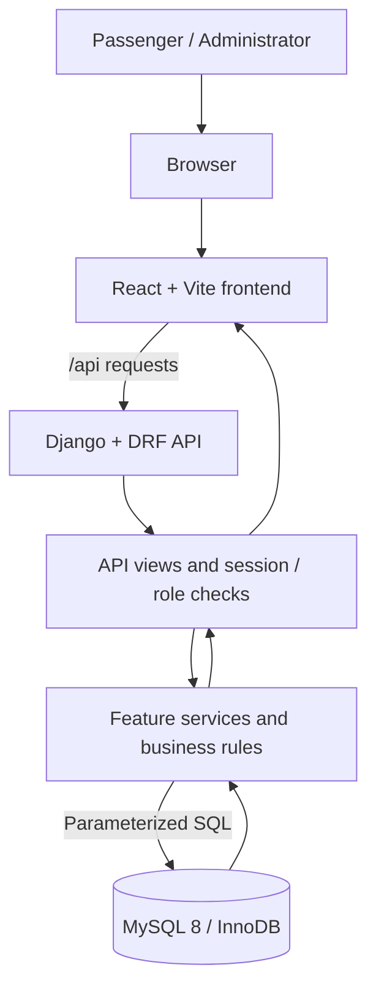

# Railway Reservation System — Project Documentation

This guide documents the repository's current implementation, local setup, database structure, application architecture, API surface, security model, and test workflow. It describes the code in this repository; it is not a claim that a production deployment or live payment gateway has been configured.

## 1. Project overview

The Railway Reservation System is a coursework web application built with:
- **Frontend:** React 19 and Vite
- **Backend:** Python 3.10+ with Django 5.2 and Django REST Framework
- **Database:** MySQL 8.0.16+ using InnoDB
- **Database driver:** `mysql-connector-python`
- **Password hashing:** Werkzeug password hash utilities

Passengers can register and sign in, search trains, check seat availability, enter passenger details, calculate fares, create bookings, make a simulated payment, view booking history/status, and cancel bookings. Administrators have a protected dashboard for managing trains, stations, routes, schedules, seat inventory, bookings, and cancellation records.

## 2. Repository layout

```text
.
├── backend/
│   ├── app/                 # Feature services and Django API views
│   ├── config/              # Django settings and URL routing
│   ├── tests/               # Backend API and service tests
│   └── manage.py
├── database/
│   ├── schema.sql           # MySQL database and table definitions
│   ├── SCHEMA_REVIEW.md     # Schema design decisions and constraints
│   └── migrations/          # Versioned SQL schema changes
├── frontend/
│   ├── src/                 # React application
│   ├── package.json
│   └── package-lock.json
├── Documents/               # Coursework requirements and project references
├── .env.example             # Environment variable template
├── requirements.txt         # Python dependencies
├── run-dev.sh               # Starts Django and Vite together
└── README.md
```

## 3. Prerequisites

Install the following before starting:
- Python 3.10 or newer
- Node.js 20 or newer and npm
- MySQL 8.0.16 or newer
- [uv](https://docs.astral.sh/uv/) for Python virtual environments and dependency installation

## 4. Local setup

Run commands from the repository root unless stated otherwise.

### 4.1 Configure Python

```bash
uv venv
source .venv/bin/activate
uv pip install -r requirements.txt
```

Windows PowerShell activation:

```powershell
.venv\Scripts\Activate.ps1
```

### 4.2 Install frontend packages

```bash
cd frontend
npm ci
cd ..
```

### 4.3 Configure MySQL and environment variables

Start the MySQL server. Create the local environment file:

```bash
cp .env.example .env
```

Edit `.env` and set the database host, port, database name, username, password, and a private random Django `SECRET_KEY`. The template defaults to database `railway_reservation`.

Create the schema:

```bash
mysql -u root -p < database/schema.sql
```

The application uses the existing SQL schema directly through `mysql-connector-python`; it does not create these tables using Django migrations. Do not commit `.env` or real credentials.

### 4.4 Start the application

```bash
./run-dev.sh
```

Open the Vite frontend at **http://127.0.0.1:5173**. The launcher starts the Django API at **http://127.0.0.1:8000** and the Vite development server; Vite forwards `/api` requests to Django. Press Ctrl+C to stop both processes.

The launcher expects `uv`, `npm`, a configured `.env`, and a running MySQL instance with the schema already created.

### 4.5 Build the frontend for Django

```bash
cd frontend
npm ci
npm run build
```

Then open **http://127.0.0.1:8000** while the Django server is running. Django serves the generated assets from `frontend/dist/`.

## 5. Architecture

The browser renders the React application. API requests use the same-origin `/api` path in development, with Vite proxying them to Django. Django URL configuration dispatches requests to API views; feature-specific services in `backend/app/` apply validation and business rules and use parameterized SQL through the MySQL connector. MySQL stores users, train operations, bookings, seat allocations, payments, cancellations, refunds, and notifications.



The project is organized by feature services, including registration, train search, seat availability, booking, payment, booking history, cancellation/refunds, and administrator operations. The database schema is defined in `database/schema.sql`; design and transaction rules are described in `database/SCHEMA_REVIEW.md`.

## 6. Database schema

The schema creates the `railway_reservation` database and uses InnoDB with `utf8mb4`. Primary keys, foreign keys, unique constraints, check constraints, and indexes protect data integrity and support common lookups.

| Table | Purpose |
|---|---|
| `users` | Passenger and administrator accounts, roles, account status, password hashes |
| `stations` | Station codes, names, city and status |
| `trains` | Train number, name and operational status |
| `routes` | Named train routes |
| `route_stops` | Ordered station stops and route distances |
| `train_routes` | Train-to-route assignments |
| `train_schedules` | Dated train runs |
| `schedule_stops` | Station and time snapshots for a scheduled run |
| `travel_classes` | Travel class definitions |
| `route_fares` | Fare for a route segment and travel class |
| `seats` | Physical seats belonging to a train and class |
| `schedule_seats` | Physical seat inventory for an individual schedule |
| `bookings` | PNR, passenger owner, journey snapshot, fare and booking status |
| `booking_passengers` | Individual passenger details and fare within a booking |
| `seat_allocations` | Held, confirmed, released or expired seat allocations |
| `payments` | Payment attempts and payment status |
| `cancellations` | Booking cancellation records |
| `cancellation_items` | Passenger-level cancellation details |
| `refunds` | Refund amounts and processing status |
| `notifications` | Notification records and delivery status |

### Main relationships

- A user can own many bookings; each booking belongs to one user and one scheduled train run.
- Trains are assigned to routes. Routes contain ordered route stops; schedules contain their own stop/time snapshots.
- A schedule has seat inventory rows. Physical seats belong to a train and travel class.
- A booking has one or more booking passengers. A seat allocation connects a booking passenger to a schedule seat.
- A booking can have payment attempts, cancellation records, cancellation items, and refund records.
- Notifications record messages associated with application events.

### Important data and transaction rules

- Booking and payment/cancellation operations must use database transactions.
- Seat allocation locks the relevant `schedule_seats` inventory row before checking for overlapping active allocations. This protects against concurrent double booking.
- A booking hold expires after 15 minutes unless payment confirms it.
- Journey segments use half-open interval overlap checks so a seat can be reused on non-overlapping portions of the same scheduled run.
- Passenger and administrator data access is scoped to the authenticated account and role.
- The application stores booking itinerary and fare snapshots so later timetable or fare changes do not rewrite an issued ticket.
- Review `database/SCHEMA_REVIEW.md` before changing schema or transaction behavior.

## 7. API reference

All API paths are relative to the application origin. JSON endpoints accept and return JSON unless noted. Mutating browser requests use the Django CSRF protection described below.

### Health and session

| Method | Endpoint | Purpose |
|---|---|---|
| GET | `/api/health` | Application health check |
| GET | `/api/health/db` | Database connectivity health check |
| GET | `/api/csrf` | Obtain a CSRF token for browser requests |
| POST | `/api/register` | Register a passenger account |
| POST | `/api/login` | Authenticate a passenger |
| GET | `/api/session` | Restore the current passenger session |
| POST | `/api/logout` | End the passenger session |

### Train search and booking

| Method | Endpoint | Purpose |
|---|---|---|
| GET | `/api/stations` | Retrieve station options |
| GET | `/api/travel-classes` | Retrieve travel class options |
| GET | `/api/trains/search` | Search scheduled trains |
| GET | `/api/seats/availability` | Check seat availability |
| POST | `/api/bookings` | Create a passenger booking |
| GET | `/api/bookings/history` | Retrieve the signed-in passenger's bookings |
| GET | `/api/bookings/status` | Look up booking status for the signed-in passenger |
| POST | `/api/bookings/<booking_id>/pay` | Submit the simulated booking payment |
| POST | `/api/bookings/<booking_id>/cancel` | Cancel a booking / passenger allocation |
| POST | `/api/bookings/<booking_id>/passengers` | Submit or update booking passenger details |
| GET | `/api/bookings/<booking_id>/fare` | Calculate or retrieve the booking fare |

### Administrator

| Method | Endpoint | Purpose |
|---|---|---|
| POST | `/api/admin/login` | Authenticate an administrator |
| POST | `/api/admin/logout` | End the administrator session |
| GET | `/api/admin/dashboard` | Retrieve operational dashboard data |
| GET | `/api/admin/cancellations` | Retrieve cancellation records |
| GET | `/api/admin/bookings/<booking_id>` | Retrieve booking details |
| POST | `/api/admin/trains` | Create a train |
| PATCH | `/api/admin/trains/<train_id>` | Update train information/status |
| POST | `/api/admin/stations` | Create a station |
| PATCH | `/api/admin/stations/<station_id>` | Update station information/status |
| POST | `/api/admin/routes` | Create a route |
| PATCH | `/api/admin/routes/<route_id>` | Update a route |
| POST | `/api/admin/train-routes` | Manage train-to-route assignments |
| POST | `/api/admin/schedules` | Create a train schedule |
| PATCH | `/api/admin/schedules/<schedule_id>` | Update a schedule |
| GET | `/api/admin/schedules/<schedule_id>/seats` | Retrieve schedule seat inventory |
| PATCH | `/api/admin/schedules/<schedule_id>/seats/<schedule_seat_id>` | Update schedule seat status |

The endpoint list reflects the URL routing currently configured in `backend/config/urls.py`. Refer to the corresponding view and service for request fields, response formats, and validation rules.

### Authentication and security

- Passenger and administrator authentication use Django signed-cookie sessions.
- Session cookies are HttpOnly and SameSite=Lax. CSRF protection is enabled for unsafe browser requests.
- Obtain the CSRF token from `GET /api/csrf` and send it as `X-CSRFToken` on POST/PATCH requests.
- Administrator APIs require an authenticated active administrator account. Public passenger registration cannot grant the ADMIN role.
- Passwords are stored as Werkzeug scrypt hashes; raw passwords are not returned by the API.
- SQL statements use parameters rather than interpolating user input.
- Production deployments must use HTTPS, a private high-entropy `SECRET_KEY`, correct `ALLOWED_HOSTS`, and secure cookie settings. Enable HSTS only after HTTPS is correctly configured.

## 8. Testing

Install Python and frontend dependencies first. From the repository root run:

```bash
cd frontend
npm ci
npm run build
cd ..
uv run --active python -m compileall -q backend
uv run --active python -m unittest discover -s backend/tests -v
```

The backend test suite covers API endpoints, service behavior, authentication/authorization, booking and cancellation flows, and application setup. Database access is mocked in the automated unit tests; these tests do not validate a live MySQL installation. A successful frontend build validates the React production bundle.

For database integration checks, start a separate local MySQL instance, create the schema from `database/schema.sql`, configure a local `.env`, and use a non-production test database. Never run destructive tests against production data.

## 9. Known scope and limitations

- The payment workflow currently uses a simulated payment provider; it is not a live card/UPI payment integration.
- Refund records and statuses are tracked by the application; an external banking/payment-provider refund settlement is not implied.
- Notification records are maintained by the application; actual email/SMS provider delivery requires separate integration and credentials.
- The SQL schema is the source of truth for the existing MySQL database. Django migrations are not used to create or alter these application tables.
- `database/SCHEMA_REVIEW.md` records additional schema assumptions and operational rules.

## 10. Troubleshooting

- **Launcher says `.env` is missing:** copy `.env.example` to `.env` and configure credentials.
- **Database connection fails:** confirm MySQL is running, the database exists, and `DB_HOST`, `DB_PORT`, `DB_NAME`, `DB_USER`, and `DB_PASSWORD` match your local setup.
- **Frontend cannot reach API:** keep both servers running with `./run-dev.sh`; confirm Django is listening on port 8000 and Vite on 5173.
- **CSRF failure:** fetch a fresh token from `/api/csrf` and include it in the `X-CSRFToken` header for unsafe requests.
- **Missing frontend build:** run `npm ci && npm run build` inside `frontend/`.

## 11. Related project files

- [Main README](../README.md)
- [Database schema](../database/schema.sql)
- [Schema design review](../database/SCHEMA_REVIEW.md)
- [Python dependencies](../requirements.txt)
- [Frontend package manifest](../frontend/package.json)
