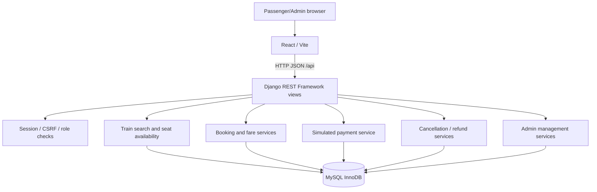

# Software Architecture and Design Specification (SAD)
**Project:** Railway Reservation System | **Version:** 1.0 | **Status:** Current-state design baseline

## 1. Introduction
This document describes the architecture, design decisions, component interfaces and security controls of the coursework reservation system. Audience: developers, testers and evaluators. Related documents: `docs/SE_SRS.md`, `docs/SE_TEST_PLAN.md`, `docs/PROJECT_DOCUMENTATION.md`.

## 2. Architecture
### 2.1 Goals, stakeholders and constraints
Goals: correct seat allocation, transaction consistency, maintainable modules, secure passenger/admin access and a usable booking workflow. Stakeholders: passengers, administrators, developers and evaluators. Constraints: existing MySQL schema, simulated payments, local development environment, no guaranteed production failover.

### 2.2 UML component diagram


### 2.3 Component descriptions
| Component | Responsibility |
|---|---|
| React frontend | Forms, search, booking steps, passenger history and admin dashboard |
| Django API views | HTTP parsing, session/role enforcement, error-to-response mapping |
| Search and availability | Schedules, fares, occupancy and overlapping segment checks |
| Booking service | Lock inventory, create PNR, passenger rows and temporary seat holds |
| Payment service | Verify holds and atomically confirm booking and seats; queue notifications |
| Cancellation/refund services | Release allocations, record cancellations and pending refunds |
| Admin services | Manage trains, stations, routes, schedules, inventory and record views |
| MySQL/InnoDB | Durable rows, foreign keys, unique constraints, transactions and locks |

### 2.4 Architecture pattern and rationale
Layered modular monolith: React presentation, Django HTTP boundary, feature-specific domain services, and MySQL persistence. This limits operational complexity relative to microservices and keeps transaction boundaries within one database. Feature modules are separated by responsibility; shared input primitives live in `backend/app/validation.py`.

### 2.5 Technology stack and data stores
React 19, Vite, Django 5.2, Django REST Framework, Python 3.10+, MySQL 8.0.16+ and `mysql-connector-python`. The schema is versioned in `database/schema.sql` and `database/migrations/`, not generated through Django ORM migrations.

### 2.6 Risks and mitigation
| Risk | Mitigation / limitation |
|---|---|
| Concurrent users double-book a seat | Inventory row locks, overlapping-segment checks, atomic commit |
| Browser retries create duplicates | Idempotency and unique PNR handling |
| Payment fails after booking hold | Pending state and safe retry/expiry handling |
| Database unavailable | Controlled errors and DB health endpoint; no automatic failover |
| Secrets exposed | Environment-based secrets, production HTTPS and secure cookies |
| Scope misunderstood | Label payment as simulated, refunds as pending, notifications as queued |

### 2.7 Traceability
SRS F-001–003 maps to authentication/views; F-004–006 to search/availability; F-007–010 to booking/fare; F-011 and F-015 to payment; F-012–014 to history/cancellation/refunds; F-016–019 to admin services; F-020 to health endpoints. SRS security requirements map to Django settings, authorization checks, parameterized SQL and transaction services.

### 2.8 Security architecture (STRIDE)
- **Spoofing:** authenticated sessions, hashed passwords, administrator role validation.
- **Tampering:** CSRF validation, parameterized SQL, input validation, InnoDB transactions.
- **Repudiation:** booking, payment, cancellation and refund records; full security audit log not established.
- **Information disclosure:** passenger ownership checks, HttpOnly cookies, HTTPS deployment requirement.
- **Denial of service:** validation and bounded search results; rate limiting is not established.
- **Elevation of privilege:** server-side role checks; public registration cannot create admin accounts.

## 3. Detailed design
### 3.1 Booking and confirmation sequence
```mermaid
sequenceDiagram
 actor P as Passenger
 participant UI as React
 participant API as Django API
 participant B as Booking service
 participant Pay as Payment service
 participant DB as MySQL
 P->>UI: Select train and enter passengers
 UI->>API: POST /api/bookings
 API->>B: Validate request
 B->>DB: BEGIN; lock inventory; create booking, passengers and HELD seats
 DB-->>B: Commit PNR
 B-->>API: Pending booking and PNR
 API-->>UI: Pending confirmation
 P->>UI: Confirm simulated payment
 UI->>API: POST /api/bookings/{id}/pay
 API->>Pay: Validate ownership and active holds
 Pay->>DB: BEGIN; lock booking/seats; record payment; confirm seats and booking; queue notifications
 DB-->>Pay: Commit
 Pay-->>UI: Confirmed booking
```

### 3.2 Cancellation sequence
```mermaid
sequenceDiagram
 actor P as Passenger
 participant UI as React
 participant API as Django API
 participant C as Cancellation service
 participant DB as MySQL
 P->>UI: Cancel eligible booking
 UI->>API: POST /api/bookings/{id}/cancel
 API->>C: Check session, ownership and rules
 C->>DB: BEGIN; lock booking and allocations
 C->>DB: Create cancellation/items and pending refunds
 C->>DB: Release seats; set booking CANCELLED; COMMIT
 DB-->>C: Cancellation record
 C-->>API: Charges, refund and status
 API-->>UI: Cancellation result
```

### 3.3 API interfaces
| Component | Method and route | Result / error handling |
|---|---|---|
| Search | GET `/api/trains/search` | Schedule options; validation errors for invalid query |
| Booking | POST `/api/bookings` | Pending booking and PNR; validation/availability/conflict errors |
| Payment | POST `/api/bookings/{id}/pay` | Simulated confirmation; unauthorized, invalid or expired hold errors |
| Cancellation | POST `/api/bookings/{id}/cancel` | Cancellation and refund details; eligibility/ownership errors |
| Admin | PATCH `/api/admin/trains/{id}` | Updated train; role, validation and duplicate errors |
| Operations | GET `/api/health/db` | 200 on connection, 503 when database unavailable |

### 3.4 Error handling, logging and monitoring
Views map expected domain failures to controlled HTTP errors. Database outages return service-unavailable responses without raw SQL exception details. `/api/health` and `/api/health/db` support basic checks; production alerting, audit retention and automated failover have not been established.

### 3.5 User experience
Passenger screens cover authentication, train search, booking, simulated payment, status/history and cancellation. Admin screens cover operations and record inspection. Automated browser checks exist; accessibility certification is not claimed.

### 3.6 Architecture decisions and open issues
Use the existing schema, preserve row-lock ordering, keep transactions inside services, and avoid duplicated business logic in views. Open limitations: real gateway integration, provider delivery, production monitoring, live database integration tests and formal performance measurements.

## 4. References
`docs/ARCHITECTURE_DECISIONS.md`, `docs/PROJECT_DOCUMENTATION.md`, `database/SCHEMA_REVIEW.md`, `backend/config/urls.py`, `backend/app/`.
