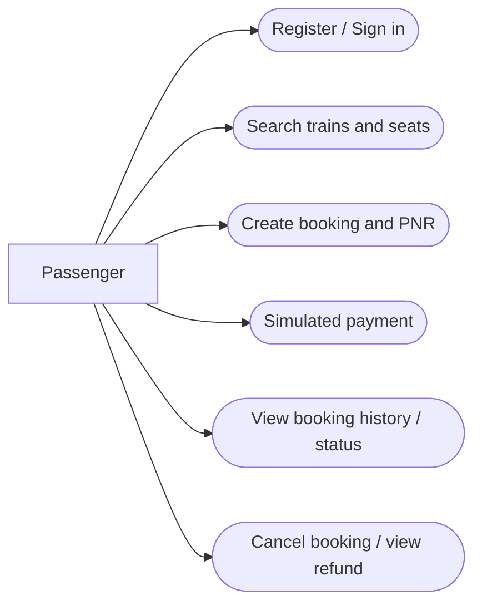
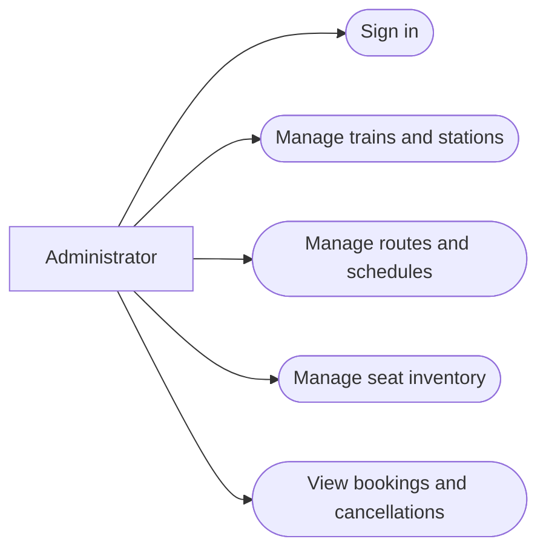

# Software Requirements Specification (SRS)
**Project:** Railway Reservation System | **Version:** 1.0 | **Status:** Baseline aligned to current implementation

## 1. Introduction
### 1.1 Purpose and scope
This specification defines the passenger reservation and railway administration workflows delivered by the React, Django REST Framework and MySQL application. The project uses simulated payments and queued notifications; it does not transfer real money or deliver SMS/email through a provider.
### 1.2 Audience and definitions
Audience: passengers, administrators, developers, testers and evaluators. PNR = Passenger Name Record; API = Application Programming Interface; CSRF = Cross-Site Request Forgery; RBAC = Role-Based Access Control; RTM = Requirements Traceability Matrix; NFR = Non-Functional Requirement.

## 2. Overall description
The browser frontend calls Django API endpoints, whose feature services use parameterized SQL against an InnoDB MySQL database. Passengers authenticate and manage their own reservations. Administrators manage railway data and view operational records. External payment and notification providers are outside the current implementation.
Dependencies: Python 3.10+, Node.js 20+, MySQL 8.0.16+, configured environment and schema. A real MySQL integration deployment is not validated by mocked unit tests.

## 3. External interfaces
- Passenger and admin web interfaces: React/Vite.
- JSON HTTP API: Django REST Framework under `/api`.
- Persistent store: MySQL via `mysql-connector-python`; schema is in `database/schema.sql`.
- Security: session cookies, CSRF tokens, role checks, password hashing, HTTPS required for production.
- External services: payment is simulated; notification and refund records are persisted but provider delivery/settlement is not included.

## 4. Functional requirements
Each FR is stated as a testable behavior. IDs are stable for the accompanying test plan.
| ID | Priority | Requirement | Acceptance evidence |
|---|---|---|---|
| RRS-F-001 | High | Register a passenger with validated inputs and hashed password. | Valid registration succeeds; invalid/duplicate data is rejected. |
| RRS-F-002 | High | Authenticate an active passenger and end the session on logout. | Login/logout and unauthorized access tests. |
| RRS-F-003 | High | Authenticate an active administrator separately from passengers. | Passenger cannot access admin endpoints. |
| RRS-F-004 | High | Return selectable stations and travel classes. | Catalog endpoints return valid options. |
| RRS-F-005 | High | Search train schedules by origin, destination and journey date. | Matching routes returned; invalid queries rejected. |
| RRS-F-006 | High | Show available seats for a selected schedule and class. | Confirmed and unexpired held allocations are excluded. |
| RRS-F-007 | High | Collect and validate passenger details for a booking. | Missing/invalid traveler data rejected. |
| RRS-F-008 | High | Calculate and preserve a fare snapshot for a reservation. | Fare returned and persisted consistently. |
| RRS-F-009 | High | Create a booking with a unique PNR and temporary seat holds. | Booking, travelers and holds commit atomically. |
| RRS-F-010 | High | Prevent duplicate bookings from request retries and overlapping seat allocation. | Idempotency and inventory-lock tests pass. |
| RRS-F-011 | High | Confirm an eligible held booking using simulated payment. | Booking and seat statuses become CONFIRMED together. |
| RRS-F-012 | High | Display passenger booking history and PNR status. | Only bookings owned by signed-in user appear. |
| RRS-F-013 | High | Cancel an eligible booking and release its seats. | Booking, allocations and cancellation rows update together. |
| RRS-F-014 | High | Calculate cancellation charges and persist pending refunds. | Passenger-level cancellation/refund rows exist. |
| RRS-F-015 | Medium | Queue booking notification records when confirmed. | Email/SMS queue rows are created where applicable; no delivery claim. |
| RRS-F-016 | High | Let administrators create, edit, deactivate or safely remove trains. | Role checks and dependency-preserving removal tests. |
| RRS-F-017 | High | Let administrators manage stations, routes and train-route assignments. | Validation and dependency checks prevent invalid updates. |
| RRS-F-018 | High | Let administrators manage schedules and seat inventory. | Existing bookings are protected from unsafe changes. |
| RRS-F-019 | Medium | Let administrators inspect bookings, cancellations and refunds. | Protected detail and search endpoints return scoped records. |
| RRS-F-020 | Medium | Expose application and database health endpoints. | API health and database outage/recovery tests. |

## 5. Non-functional requirements
These are evaluation targets, not assertions that production metrics have been measured.
| ID | Category | Measurable requirement / verification |
|---|---|---|
| RRS-NF-001 | Performance | Train search P95 latency at or below 3 seconds under a documented representative load; run `scripts/benchmark_train_search.py` against a test MySQL database. |
| RRS-NF-002 | Availability | Target 99.5% monthly availability excluding announced maintenance; verify with operational uptime measurements (not yet established). |
| RRS-NF-003 | Reliability | Booking, payment and cancellation multi-row changes are atomic; inject failures and verify rollback and idempotent retries. |
| RRS-NF-004 | Compatibility | Main screens render in Chrome, Firefox, Edge and Safari; execute Playwright browser suite and record results. |
| RRS-NF-005 | Maintainability | Backend unit suite, Python compilation and frontend build complete successfully on every reviewed PR; inspect GitHub Actions logs. |

### 5.1 Security objectives
- **SO-01:** Prevent unauthorized access to passenger reservations and administrative operations.
- **SO-02:** Protect credentials and transactional integrity against disclosure, forgery and concurrent updates.

### 5.2 Security requirements
| ID | Requirement | Acceptance test |
|---|---|---|
| RRS-SR-001 | Store passwords using a one-way password hash; never return hashes in API responses. | Registration/authentication tests and response inspection. |
| RRS-SR-002 | Require an authenticated session and enforce passenger ownership/admin RBAC. | Unauthorized and cross-user endpoint tests. |
| RRS-SR-003 | Enforce CSRF checks on state-changing browser requests. | Missing/invalid CSRF token tests. |
| RRS-SR-004 | Use parameterized SQL and validate IDs and request fields. | Input validation and source review. |
| RRS-SR-005 | Use secure cookies and HTTPS for production; never commit secrets. | Configuration review of production deployment. |

## 6. Quality attributes and acceptance
High-priority FRs must be demonstrated, security tests must pass, critical defects must be resolved, and the RTM must identify execution evidence. Tests with mocked database access are not substitutes for real database integration testing.

## 7. UML use-case diagrams
### 7.1 Passenger

### 7.2 Administrator

## 8. Requirements traceability matrix (RTM)
| Requirements | Module / API | Test references | Status |
|---|---|---|---|
| F-001–003, SR-001–003 | Registration, auth and Django views | TC-01, TC-02, backend auth tests | Automated coverage present; rerun required |
| F-004–006, NF-001 | Search and availability | TC-03, TC-04, benchmark script | Performance measurement pending |
| F-007–010, NF-003 | Booking, fare and allocation | TC-05, TC-06, booking tests | Automated coverage present |
| F-011, F-015 | Booking payment | TC-07, payment tests | Simulated only |
| F-012–014 | History, cancellation and refunds | TC-08, TC-09, cancellation tests | Automated coverage present |
| F-016–019 | Admin modules | TC-10, admin tests | Automated coverage present |
| F-020, NF-002 | Health and recovery | TC-11, recovery tests | Availability measurement pending |
| NF-004, NF-005 | Frontend and CI | TC-12, build and browser suite | Latest run verification pending |
| SR-004–005 | SQL services and settings | TC-13, source/configuration review | Deployment verification pending |

## 9. Deviations and limitations
Real payment processing, bank refunds, email/SMS delivery and production high availability are **not implemented**. The original SRS/SAD should be compared with this current-state baseline and any scope changes explained during the demo. Requirements here reflect code/documentation reviewed, not independently executed acceptance tests.

## 10. References
`README.md`, `docs/PROJECT_DOCUMENTATION.md`, `docs/ARCHITECTURE_DECISIONS.md`, `database/schema.sql`, `backend/tests/`, `frontend/tests/`.
