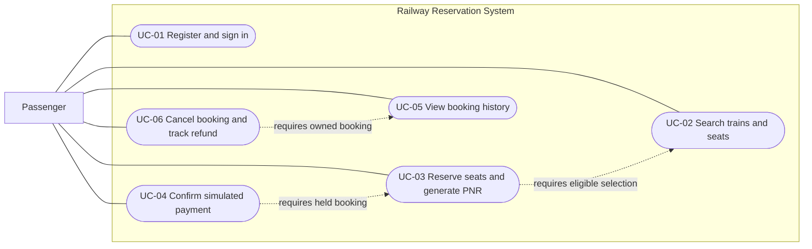
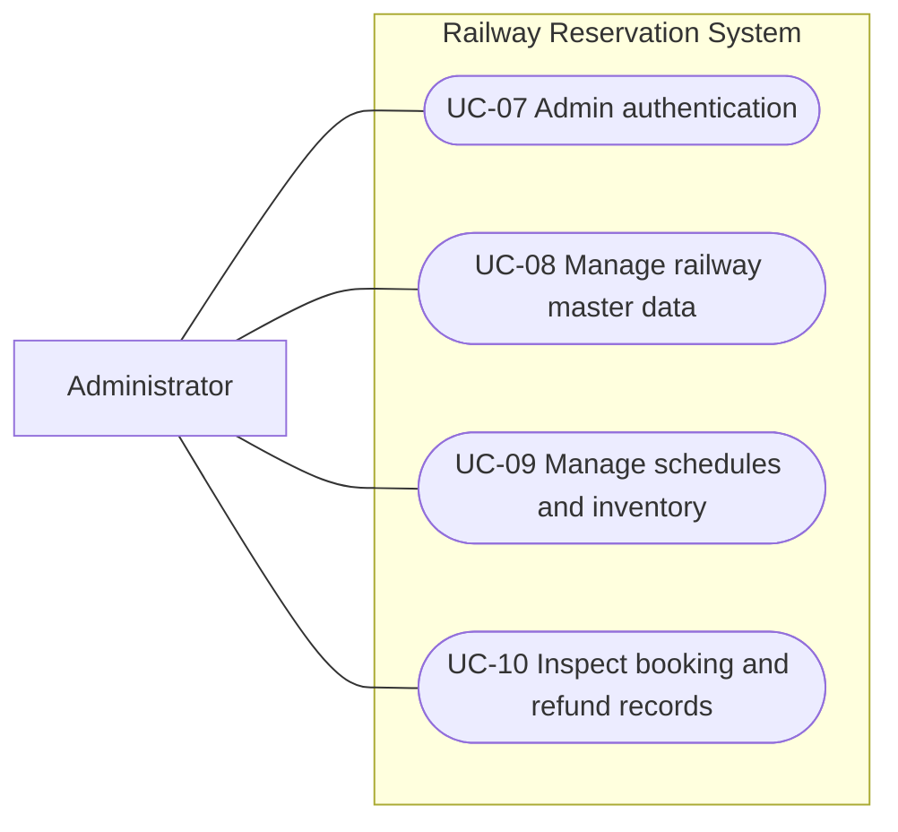

# USE CASE SPECIFICATIONS
## Railway Reservation System
**Document type:** Software Engineering — Use Case Specifications  
**Version:** 1.0 | **Date:** 19 November 2026  
**Related documents:** [Software Requirements Specification](SE_SRS.md) · [Test Plan](SE_TEST_PLAN.md) · [System Validation Report](SYSTEM_VALIDATION_REPORT.md)

---

## 1. Introduction
### 1.1 Purpose
This document specifies the interactions between external actors and the Railway Reservation System. It defines the system boundary, use-case model, normal flows, alternative flows, exception handling, and requirement traceability. It describes intended system behavior; it is **not** a record of successful end-to-end validation.

### 1.2 Scope
Passenger registration and authentication, train search, seat availability, booking, Passenger Name Record (PNR), simulated payment, booking history, cancellation, pending refund records, and administrator operations. Real payment settlement, bank refunds, and externally delivered notifications are outside the implemented scope.

## 2. Actors
| Actor | Description | Responsibilities |
|---|---|---|
| Passenger | Registered user booking railway journeys | Register, log in, search, book, simulate payment, view/cancel own bookings |
| Administrator | Authorized railway operations user | Log in; manage stations, trains, routes, schedules and inventory; inspect records |
| System clock (supporting trigger) | Time-based process/condition | Determines hold expiry and date-dependent booking eligibility |
| MySQL database (internal component, **not** an external actor) | Persistent application data store | Stores users, inventory, bookings and records |

**System boundary:** React browser interface and Django backend constitute the application; MySQL is an internal dependency. Simulated payment is an internal workflow rather than an external payment-gateway actor.

## 3. Use-Case Diagram
The following UML-style diagrams show actor-to-use-case associations. They are separated for readability.

### 3.1 Passenger

### 3.2 Administrator

## 4. Use-Case Summary
| ID | Use case | Primary actor | Priority | Requirements |
|---|---|---|---|---|
| UC-01 | Register and sign in | Passenger | High | RRS-F-001–002 |
| UC-02 | Search trains and check seats | Passenger | High | RRS-F-004–006 |
| UC-03 | Reserve seats and generate PNR | Passenger | High | RRS-F-007–010 |
| UC-04 | Confirm simulated payment | Passenger | High | RRS-F-011, RRS-F-015 |
| UC-05 | View booking history | Passenger | High | RRS-F-012 |
| UC-06 | Cancel booking and track refund | Passenger | High | RRS-F-013–014 |
| UC-07 | Administrator authentication | Administrator | High | RRS-F-003 |
| UC-08 | Manage railway master data | Administrator | High | RRS-F-016–017 |
| UC-09 | Manage schedules and inventory | Administrator | High | RRS-F-018 |
| UC-10 | Inspect booking and refund records | Administrator | Medium | RRS-F-019 |

## 5. Detailed Use-Case Specifications
Each use case follows a consistent template: **ID, name, actors, goal, trigger, preconditions, main success scenario, alternative/exception flows, postconditions, and related requirements**.

### UC-01 — Passenger Registration and Sign-In
**Primary actor:** Passenger  
**Goal:** Create an account or authenticate an existing passenger.  
**Trigger:** Passenger chooses Register or Sign In.  
**Preconditions:** Application is available; for sign-in, an active account exists.

**Main success scenario**
1. Passenger opens the registration form.
2. Passenger enters required account details.
3. System validates inputs and checks for duplicate account data.
4. System stores the account using a one-way password hash.
5. Passenger enters valid sign-in credentials.
6. System establishes an authenticated passenger session.

**Alternative and exception flows:** Invalid or duplicate registration data is rejected; incorrect or inactive credentials deny access; missing authentication blocks protected actions.  
**Postconditions:** Passenger account exists and/or a valid session is established.  
**Requirements:** RRS-F-001, RRS-F-002, RRS-SR-001–003.

### UC-02 — Search Trains and Check Seat Availability
**Primary actor:** Passenger  
**Goal:** Identify a valid journey and available seats.  
**Trigger:** Passenger submits a journey search.  
**Preconditions:** Station and schedule data exist.

**Main success scenario**
1. System displays station and travel-class options.
2. Passenger selects origin, destination and journey date.
3. System validates search criteria.
4. System retrieves matching train schedules.
5. Passenger selects a train and class.
6. System displays fare and available seats after accounting for confirmed and unexpired held allocations.

**Alternative and exception flows:** No matching train produces an empty result; invalid station, class or date produces a validation error. Past-date rejection is an acceptance requirement that must be verified against the deployed backend.  
**Postconditions:** An eligible train and class can be selected.  
**Requirements:** RRS-F-004–006.

### UC-03 — Reserve Seats and Generate PNR
**Primary actor:** Passenger  
**Goal:** Create a held reservation with a unique Passenger Name Record (PNR).  
**Trigger:** Passenger selects Book.  
**Preconditions:** Passenger is authenticated; eligible schedule and inventory are available.

**Main success scenario**
1. Passenger supplies traveler details.
2. System validates traveler details and calculates the fare.
3. System checks and locks the necessary inventory for allocation.
4. System creates the booking, travelers and temporary seat holds atomically.
5. System generates a unique PNR and displays booking status.

**Alternative and exception flows:** Invalid traveler details are rejected; insufficient inventory prevents booking; concurrent conflicts and database errors roll back the transaction; repeated requests with the same idempotency key must not allocate seats twice.  
**Postconditions:** A held booking with a PNR exists, or no partial reservation persists.  
**Requirements:** RRS-F-007–010, RRS-NF-003.

### UC-04 — Confirm Simulated Payment
**Primary actor:** Passenger  
**Goal:** Confirm an eligible held booking through the demo payment workflow.  
**Trigger:** Passenger selects simulated payment confirmation.  
**Preconditions:** Passenger owns a valid, unexpired held booking.

**Main success scenario**
1. Passenger opens payment confirmation for the held booking.
2. System validates ownership, booking state and hold validity.
3. System records the simulated payment result.
4. System confirms the booking and seat allocations consistently.
5. System creates applicable notification queue records.
6. System displays confirmed booking status and PNR.

**Alternative and exception flows:** Expired holds, unauthorized requests or invalid booking states are rejected; retries must not duplicate payment records.  
**Postconditions:** Booking is confirmed in the application. **No real money transfer or notification delivery is implied.**  
**Requirements:** RRS-F-011, RRS-F-015.

### UC-05 — View Booking History
**Primary actor:** Passenger  
**Goal:** Review previously created reservations and their current status.  
**Trigger:** Passenger opens Booking History or searches own PNR.  
**Preconditions:** Passenger is authenticated.

**Main success scenario**
1. Passenger opens booking history.
2. System identifies the authenticated account.
3. System returns only reservations owned by that account.
4. Passenger selects a reservation to view PNR, travelers and status.

**Alternative and exception flows:** No bookings yields an empty state; cross-user access is denied.  
**Postconditions:** No reservation data is modified.  
**Requirements:** RRS-F-012, RRS-SR-002.

### UC-06 — Cancel Booking and Track Refund
**Primary actor:** Passenger  
**Goal:** Cancel an eligible booking and view resulting refund status.  
**Trigger:** Passenger requests cancellation.  
**Preconditions:** Passenger is authenticated, owns the booking and satisfies cancellation rules.

**Main success scenario**
1. Passenger selects an eligible reservation.
2. System validates ownership and cancellation eligibility.
3. System calculates applicable cancellation charges.
4. System updates booking/cancellation records and releases eligible seats atomically.
5. System records pending refund information and shows updated status.

**Alternative and exception flows:** Unauthorized or ineligible cancellation is rejected; failed transactions are rolled back; repeat cancellation must not duplicate releases or refunds.  
**Postconditions:** Booking is cancelled and any pending refund is recorded. **External bank payout is not implemented.**  
**Requirements:** RRS-F-013–014, RRS-NF-003.

### UC-07 — Administrator Authentication
**Primary actor:** Administrator  
**Goal:** Access restricted railway administration functions.  
**Trigger:** Administrator submits credentials.  
**Preconditions:** Active administrator account exists.

**Main success scenario**
1. Administrator opens the admin sign-in page.
2. Administrator enters credentials.
3. System verifies identity and administrative role.
4. System establishes the authorized session and displays permitted functions.

**Alternative and exception flows:** Invalid credentials, disabled accounts and passenger-role sessions are denied.  
**Postconditions:** Administrator is authenticated with role-restricted access.  
**Requirements:** RRS-F-003, RRS-SR-002.

### UC-08 — Manage Railway Master Data
**Primary actor:** Administrator  
**Goal:** Maintain trains, stations, routes and train-route assignments.  
**Trigger:** Administrator opens the corresponding management function.  
**Preconditions:** Authorized admin session exists.

**Main success scenario**
1. Administrator selects a train, station or route management action.
2. System presents current records.
3. Administrator enters create, update or deactivate details.
4. System validates references and dependencies.
5. System persists permitted changes and displays the updated records.

**Alternative and exception flows:** Invalid references, duplicate identifiers, dependency violations or unauthorized changes are rejected.  
**Postconditions:** Valid master-data changes are stored without breaking dependent bookings.  
**Requirements:** RRS-F-016–017.

### UC-09 — Manage Schedules and Seat Inventory
**Primary actor:** Administrator  
**Goal:** Maintain schedule and inventory data safely.  
**Trigger:** Administrator opens schedule or inventory management.  
**Preconditions:** Authorized admin session and relevant train/route records exist.

**Main success scenario**
1. Administrator selects a train, route or schedule.
2. System displays existing schedules and inventory.
3. Administrator submits permitted schedule or seat changes.
4. System checks consistency and existing booking dependencies.
5. System commits valid updates and displays the result.

**Alternative and exception flows:** Invalid times, missing dependencies or unsafe reductions affecting booked seats are rejected.  
**Postconditions:** Schedules/inventory remain consistent with existing allocations.  
**Requirements:** RRS-F-018.

### UC-10 — Inspect Booking, Cancellation and Refund Records
**Primary actor:** Administrator  
**Goal:** Inspect reservation operations for support and oversight.  
**Trigger:** Administrator opens operational records.  
**Preconditions:** Authorized admin session exists.

**Main success scenario**
1. Administrator opens the booking-management view.
2. System retrieves permitted booking summaries and details.
3. Administrator filters or selects a booking, cancellation or refund record.
4. System displays associated status and audit-relevant information.

**Alternative and exception flows:** Invalid filters return errors or empty results; unauthorized requests are rejected.  
**Postconditions:** Operational records remain unchanged by inspection.  
**Requirements:** RRS-F-019, RRS-SR-002.

## 6. Use-Case Relationships and Business Rules
- **Authentication:** UC-03 through UC-06 require a passenger session; UC-08 through UC-10 require an administrator session.
- **Booking dependency:** UC-03 follows an eligible selection from UC-02; UC-04 requires an unexpired hold from UC-03.
- **Ownership:** A passenger can view, pay for or cancel only their own reservation.
- **Concurrency:** Inventory locking and idempotency protect against overlapping allocations and duplicate retries.
- **Consistency:** Reservation, payment and cancellation state changes should be atomic.
- **Time:** Expired holds cannot be confirmed; invalid or past journey dates must be rejected according to requirements.
- **Financial boundary:** Payment is simulated and refunds are pending records, not settled transfers.

## 7. Traceability to Test Plan
| Use case | Test-plan coverage | Validation boundary |
|---|---|---|
| UC-01 | TC-01, TC-02; authentication unit tests | Live database authentication not fully reverified |
| UC-02 | TC-03, TC-04 | Search benchmark and live inventory verification pending |
| UC-03 | TC-05, TC-06 | Transaction/concurrency integration pending |
| UC-04 | TC-07 | Simulated payment only |
| UC-05, UC-06 | TC-08, TC-09 | Live cancellation/refund integration pending |
| UC-07–UC-10 | TC-10; admin tests | Live database administrative workflows pending |

## 8. Assumptions, Constraints and References
**Assumptions:** Current SRS in `docs/SE_SRS.md` is the requirement baseline; behavior that has not been executed against a real MySQL instance remains unverified.

**Constraints:** The documented implementation does not include a real payment gateway, external refund settlement or email/SMS delivery. The system validation report remains conditional where integration and cross-browser evidence is missing.

**References:** `docs/SE_SRS.md`, `docs/SE_TEST_PLAN.md`, `docs/SYSTEM_VALIDATION_REPORT.md`, `database/schema.sql`, `backend/tests/`.

---
**Format note:** This is a standalone use-case-specification artifact, matching the reference repository's separation of SRS, test plan, use-case specifications and use-case diagram. Exact PDF typography from the other group's binary document has not been independently verified.
